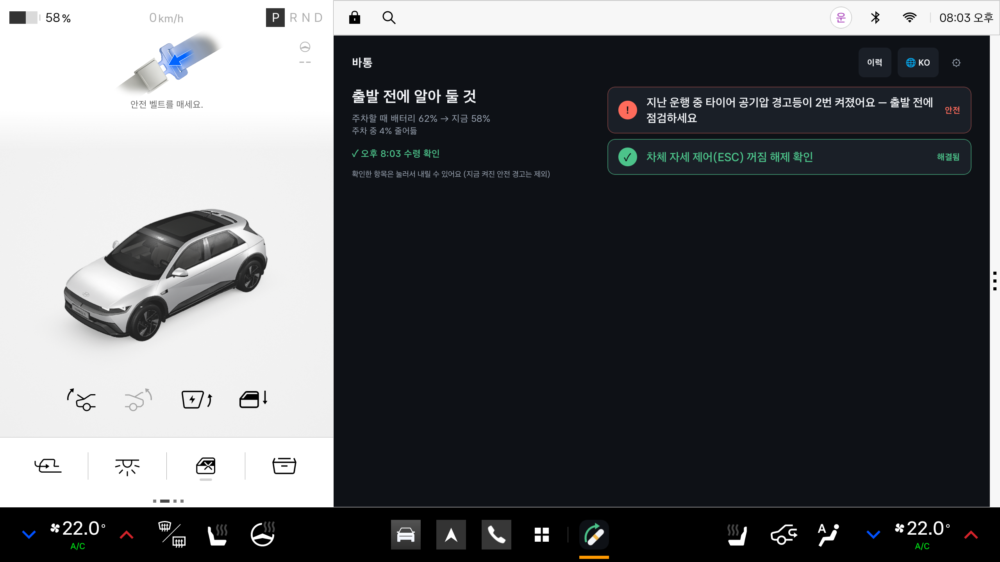
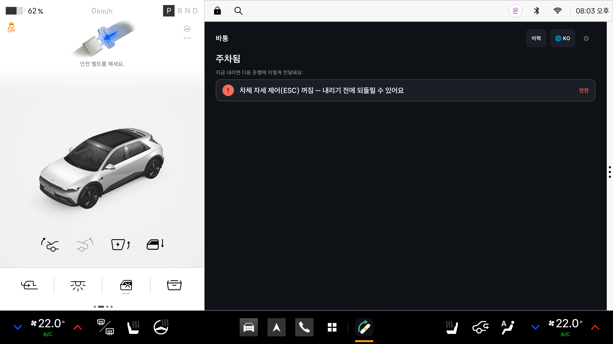
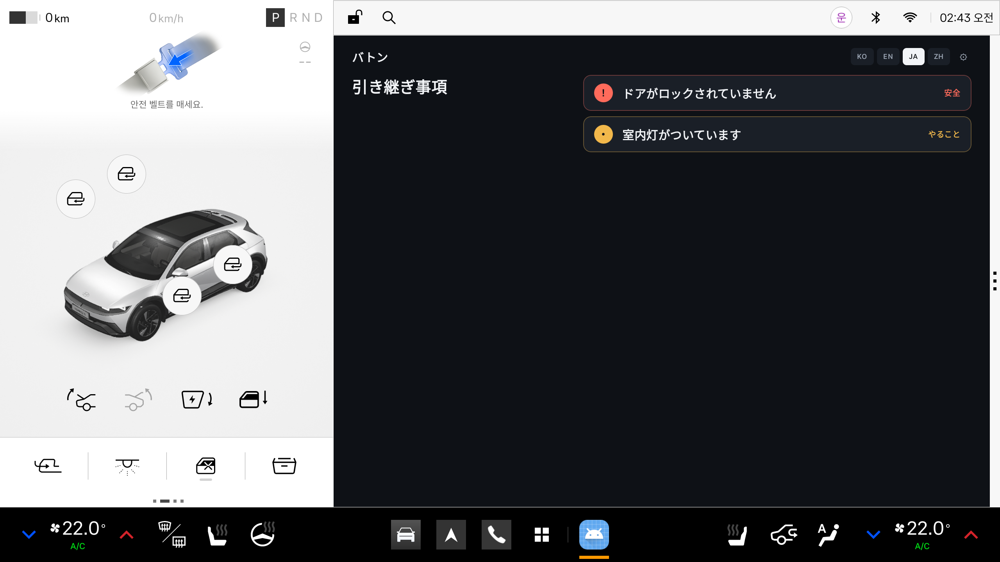

# 바통 (Baton)

> 차를 넘겨받는 다음 운전자에게, **계기판에 남지 않는 지난 운행의 경고**와 **앞사람이 바꿔 둔 안전 설정**을 차 안에서 알려 주고, 차량 신호로 해결이 확인되는 순간 스스로 지우는 차량 인수인계 앱.

현대자동차그룹 차량용 앱 개발 공모전(Pleos Connect, Android Automotive OS) 출품작입니다.

| 다음 운전자 탑승: 지난 운행 경고 + 바뀐 설정 | ESC를 다시 켜면 '해제 확인', 수령증 |
|---|---|
|  |  |

| 내리기 전 미리보기 (떠나는 사람) | 받는 사람 언어로 (일본어) |
|---|---|
|  |  |

## 왜 필요한가

- 앞사람 운행 중 **타이어 공기압 경고가 켜졌다 꺼졌다면**, 다음 운전자는 시동을 걸어도 알 수 없습니다. 경고는 이미 꺼져 있으니까요.
- 앞사람이 **ESC를 끄거나 i-Pedal(원페달)을 켜 두고** 내렸다면, 다음 운전자는 모르고 출발해 다른 거동을 겪습니다.
- 차량 순정 경고는 '지금 운전자'에게, 블루링크 같은 원격 서비스는 '차주 휴대폰'에게 갑니다. **다음 운전자에게 차 안에서 넘기는 경로는 비어 있습니다.**
- 미국은 상용차에 대해 운행 후 결함 기록과 **다음 운전자의 출발 전 검토·서명**을 법으로 요구합니다(49 CFR 396.11·396.13, DVIR). 바통은 그 원칙을 차량 신호로 자동화해 승용·가족·카셰어링으로 옮깁니다.

## 무엇을 넘기나

| 넘기는 것 | 예 | 등급 |
|---|---|---|
| **지난 운행 중 켜졌다 꺼진 고장 경고 (횟수)** | "지난 운행 중 타이어 공기압 경고등이 2번 켜졌어요 — 출발 전에 점검하세요" | 경고 종류에 따라 안전·할 일 |
| **바꿔 둔 설정** | ESC 꺼짐, 조수석 에어백 꺼짐, i-Pedal, 크리프 해제, 견인·스포츠 모드 | 안전·할 일·참고 |
| **지금 켜진 고장 경고** | 12V 배터리, EV 시스템, 엔진오일 압력, 냉각수, MDPS, 에어백 | 대부분 안전 |
| **소모품·에너지** | 브레이크액·엔진오일·변속기 오일·워셔액 부족, 배터리 20% 이하, 주차 중 충전량 | 안전·할 일·참고 |

**넘기지 않는 것**
- 문 잠금·창문·실내등: 순정 경고와 블루링크가 이미 다룹니다. 다음 운전자는 어차피 자기가 열고 탑니다.
- 운전 습관 신호(과속·운전자 주의 경고·안전벨트): **기록 자체를 하지 않습니다**(감시 도구가 되지 않도록).

경고등 분류표(DVIR 점검 범주 대응): [`handover/Telltales.kt`](app/src/main/java/com/baton/app/handover/Telltales.kt)

## 흐름

1. **운행 중**: 고장 경고등이 켜질 때마다 셉니다.
2. **하차**: P단 + 운전석이 2초 이상 비면, 지금 상태와 운행 기록을 인계로 저장합니다. 내리기 전 주차 화면에서 "ESC 꺼짐 — 내리기 전에 되돌릴 수 있어요"를 미리 보여 줍니다.
3. **탑승**: 다음 운전자가 앉으면 화면과 음성으로 한 번 안내합니다("출발 전에 알아 두실 것이 2가지 있어요"). 문제가 없으면 "넘겨받을 것이 없어요".
4. **해결**: ESC를 다시 켜는 등 신호로 해결이 확인되면 "해제 확인"과 함께 지웁니다. 지난 운행 기록은 확인 처리로 내리고, **지금 켜진 안전 경고는 숨길 수 없습니다.**
5. **수령증**: "받았어요" 1탭 = DVIR의 '다음 운전자 검토·서명'. 카셰어링에서는 "받기 전부터 있던 경고"의 기록이 됩니다.
6. **출발**: 지금 켜진 안전 경고를 남긴 채 출발하면 한 번만 음성으로 알리고, 인계는 이력으로 보관합니다.

앱을 열지 않아도 동작합니다. 차량이 켜지면 바통이 스스로 시작합니다(부팅 수신 + 감시 서비스).

## 설계 특징

- **차량 구성 자동 인식**: 차종표 없이 SDK 기능 확인으로 좌석·경고등·소모품 지원 여부와 운전석 위치(좌·우핸들)를 읽습니다. 지원하지 않는 신호는 자동으로 숨깁니다.
- **받는 사람 언어로**: 인계는 `종류 + 경고등 코드 + 값`으로 저장되어 받는 사람 언어로 보입니다. 한국어·영어·일본어·중국어(경고등·설정 이름 38종). 새 언어는 `res/values-xx/strings.xml` 추가.
- **모름 ≠ 해결**: 신호 값이 아직 안 들어왔으면 해결로 치지 않습니다.
- **사람이 아니라 차를 넘긴다**: 신원을 비교하지 않고 "지난 운행에서"로 말합니다.

## 보안
- **차량 조작 기능 없음**: 차량 제어 권한(`CONTROL_*`)을 요청하지 않고 제어 코드도 없어, 어떤 상황에서도 바통을 통해 차량이 움직이지 않습니다.
- **암호화 저장**: AES-256-GCM, 키는 Android Keystore. 변조되면 감지해 버립니다.
- **최소 권한·오프라인**: 인터넷 권한 없음, 백업·기기 간 이전 차단, 서비스·수신기 외부 공개 안 함.
- **release 강화**: R8 난독화, 로그 완전 차단, Gradle 배포판 체크섬 고정.
- 경고등 읽기 권한 `PRIVATE_CAR_SAFETY`는 Pleos에서 normal 등급으로 제공됩니다(지원·허용되지 않는 차량에서는 자동으로 꺼짐).
- 상세: [docs/SECURITY.md](docs/SECURITY.md)

## 테스트
- 단위 테스트: `./gradlew testDebugUnitTest` (상태 머신·경고등 운행 기록·저장 형식·악성 입력·음성 안내 판단·다국어 완전성)
- 에뮬레이터 E2E: `bash tools/e2e.sh` (실제 신호 주입 → 앱 로그로 합격 판정)
- 전체 케이스 목록: [docs/TEST_CASES.md](docs/TEST_CASES.md)

## 구조
```
vehicle/   VehicleProfile(차량 구성) · ProfileDiscovery(자동 인식) · DriverSeat(좌·우핸들) · VehicleSignals(실시간 신호) · Quirks(플랫폼 보정)
handover/  Telltales(경고등 분류표, DVIR 기준) · OpenItem · Detector · HandoverMachine(운행 기록·인계) · Announcer(음성 판단) · HandoverCodec · HandoverStore(암호화 저장)
security/  SecureFile(AES-256-GCM + Keystore) · BatonLog(release 로그 차단)
i18n/      ItemText(받는 사람 언어로 문장) · TelltaleNames(생성됨) · AppLanguage
voice/     Speaker(Pleos TTS, 온디바이스)
ui/        HandoverScreen · HistoryScreen
BatonApp · BatonController · HandoverService(감시) · BootReceiver(자동 시작)
```

## 빌드와 실행

> 처음이라면 단계별 안내서 [docs/USER_GUIDE.md](docs/USER_GUIDE.md) 를 보세요.

- JDK 17, Android SDK Platform 35, Pleos Connect 에뮬레이터(API 34 Automotive)
```bash
./gradlew assembleDebug            # 디버그
./gradlew assembleRelease          # 릴리스 → apk/바통랩_바통_release.apk (서명 키: BATON_KEYSTORE_PROPS 또는 C:/dev/keys/keystore.properties)
```

### 시연
```bash
adb forward tcp:8088 tcp:8088      # Pleos Virtual Console
bash tools/demo.sh                 # 운행 중 타이어 경고 2번 + ESC 끈 채 하차 → 다음 운전자 안내 → ESC 다시 켜면 해제 확인 → 출발
bash tools/vc.sh lamp TPMS On      # 경고등 조작 (lamp 이름 On|Off [Red|Yellow]) · gear · seat · soc
bash tools/record_demo.sh out/     # 시연 녹화: 화면 + 차량 음성 + 장면 시각 (PC 소리 녹음에 soundcard 패키지 필요)
python tools/make_video.py out/ demo.mp4   # 자막·시작/끝 카드 합성 (ffmpeg 필요)
```

## 확인된 플랫폼 제약 (에뮬레이터 v2.1.0 기준)
- 타이어 공기압 수치는 시스템 전용 권한(`CAR_TIRES`)이라 읽을 수 없어, TPMS 경고등으로 대응합니다.
- 에뮬레이터 착석 값이 반전되어 들어와 `Quirks`에서 보정합니다.
- Pleos는 운전자 프로필을 Android 사용자 단위로 나눕니다(시스템 사용자 0 + 운전자 10). 앱 기록이 프로필마다 따로 저장되므로 지금은 같은 프로필로 타는 차에서만 인계됩니다. 프로필 간 인계에는 플랫폼의 차량 단위 공용 저장소(제안)나 운영사 서버 연동이 필요합니다.
- 표준 Android TTS가 초기화되지 않아 Pleos TTS SDK를 씁니다. 온디바이스 음성은 한국어·영어(일본어·중국어는 화면).
- 앱 내부 Resources 언어 지정이 무시되어 앱별 언어 API로 화면 언어를 바꿉니다.
- release(R8)는 Pleos SDK 내부 Gson 제네릭 정보 유지 규칙이 필요합니다(`app/proguard-rules.pro`).

## 출처

| 무엇 | 출처 | 라이선스 |
|---|---|---|
| Pleos Vehicle SDK 2.3.2, TextToSpeech SDK 3.3.1 | https://nexus-playground.pleos.ai/repository/maven-releases/ | 공모전 제공 SDK |
| Pleos SDK 문서, 앱 심사 가이드 | https://document.pleos.ai | — |
| Pleos 샘플 앱 README (사용 순서 참고, 코드 미사용) | https://github.com/Pleos-Playground/pleos-sample-vehicle-app | 라이선스 미표기 → 코드 사용 안 함 |
| 49 CFR 396.11·396.13 (DVIR) | https://www.law.cornell.edu/cfr/text/49/396.11 , https://www.law.cornell.edu/cfr/text/49/396.13 | 공공 법령 |
| AndroidX, kotlinx-coroutines, AGP, Kotlin, Gradle | https://developer.android.com , https://kotlinlang.org , https://gradle.org | Apache-2.0 |
| JUnit 4.13.2, org.json (테스트) | https://junit.org/junit4/ , https://github.com/stleary/JSON-java | EPL-1.0, Public Domain |
| Gson R8 규칙 | https://github.com/google/gson/blob/main/Troubleshooting.md | Apache-2.0 |
| NHTSA 주의분산 가이드라인, Android for Cars 품질 가이드, OWASP MASVS | https://www.nhtsa.gov/sites/nhtsa.gov/files/811781.pdf , https://developer.android.com/docs/quality-guidelines/car-app-quality , https://mas.owasp.org/ | 공공 문서·CC BY-SA |

앱 아이콘과 화면 디자인은 직접 제작했습니다.
