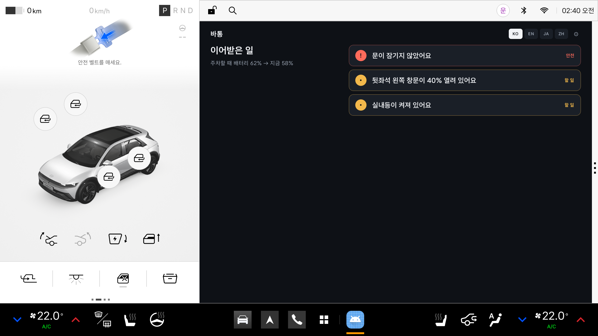
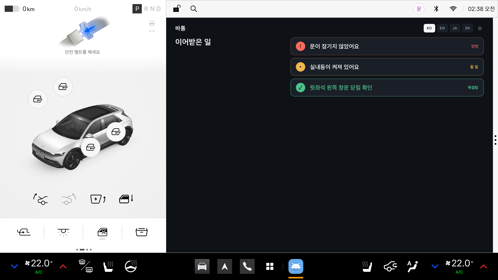
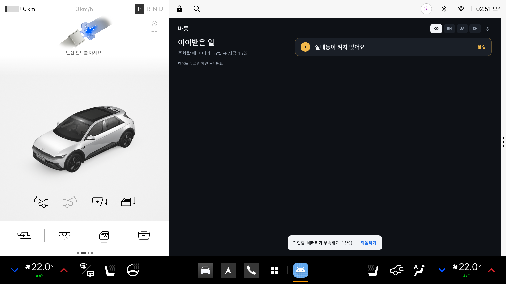

# 바통 (Baton)

> 주차하는 순간 **아직 끝나지 않은 일**을 차가 스스로 기억했다가, 다음 운전자가 타면 차 안 화면과 음성으로 알려 주고, **해결되는 순간 스스로 지우는** 차량 인수인계 앱.

현대자동차그룹 차량용 앱 개발 공모전(Pleos Connect, Android Automotive OS) 출품작입니다.

| 다음 운전자 탑승 시 (한국어) | 창문을 닫는 순간 자동 소거 |
|---|---|
|  |  |

| 받는 사람 언어로 표시 (일본어) | 확인 처리 + 되돌리기 |
|---|---|
|  |  |

## 무엇을 하나요

1. **자동 기록**: 기어가 P에 있고 모든 좌석이 비면(하차), 그 순간의 미해결 항목을 차량 신호로 기록합니다. 사람이 입력할 필요가 없습니다.
2. **차 안에서 인계**: 다음 사람이 앉으면 항목을 우선순위(안전 → 할 일 → 참고) 순서로 보여 주고 음성으로 한 번 요약합니다.
3. **신호로 확인되면 자동 소거**: 창문이 닫히거나 문이 잠기는 등 차량 신호로 해결이 확인되면 "○○ 닫힘 확인"이라고 알리고 목록에서 지웁니다.
4. **에너지 인계**: 주차할 때 배터리 잔량과 지금 잔량을 함께 보여 줍니다.
5. **확인 처리 + 되돌리기**: 신호로 해결할 수 없는 항목(예: 배터리 부족)은 눌러서 확인 처리하고, 8초 안에 되돌릴 수 있습니다.

### 현재 감지 항목
| 항목 | 우선순위 | 해결 확인 |
|---|---|---|
| 문 잠기지 않음 | 안전 | 도어 잠금 신호 |
| 문 열림(위치별) | 안전 | 도어 위치 신호 |
| 트렁크 열림 | 안전 | 트렁크 위치 신호 |
| 창문 열림(위치별, %) | 할 일 | 창문 위치 신호 |
| 실내등 켜짐 | 할 일 | 실내등 상태 신호 |
| 배터리 부족(20% 이하) | 할 일 | SoC 신호 / 확인 처리 |

## 설계 특징

- **차량 구성 자동 인식**: 차종·연식표 없이 SDK 기능 확인 API로 그 차에 실제 있는 문·창문·좌석·트렁크를 읽어 프로필을 만듭니다. 2열 5인승부터 3열 이상 승합차까지 같은 코드로 처리하고, 없는 부위·신호는 자동으로 숨깁니다.
- **언어 중립 저장 → 받는 사람 언어로 표시**: 인계는 문장이 아니라 `종류 + 위치 코드(R2L 등) + 값`으로 저장합니다. 남긴 사람과 받는 사람의 언어가 달라도 받는 사람 언어로 보입니다. 화면 언어는 한국어·영어·일본어·중국어(간체)이고, 새 언어는 `res/values-xx/strings.xml` 하나만 추가하면 됩니다.
- **오프라인 우선·개인정보 최소화**: 인계는 차량 내부 앱 전용 저장소에만 둡니다. 위치·얼굴·음성은 저장하지 않으며, 탑승 판단은 좌석·기어 신호만 씁니다.
- **주행 중 최소 표시**: P단이 아니면 한 줄 상태만 표시합니다. 상세 인계와 음성은 주차 중에만 동작합니다.
- **전원이 꺼져도 유지**: 하차 순간의 인계는 저장되어, 앱이 종료되거나 차량 전원이 꺼진 뒤에도 다음 탑승 때 이어집니다.

## 구조

```
vehicle/   Spot·VehicleProfile(차량 구성) · ProfileDiscovery(자동 인식) · VehicleSignals(실시간 신호) · Quirks(플랫폼 보정)
handover/  OpenItem(인계 항목) · Detector(미해결 탐지) · HandoverMachine(주행→주차→하차→탑승→출발) · HandoverStore(저장)
i18n/      ItemText(받는 사람 언어로 문장 생성) · AppLanguage(앱별 언어)
voice/     Speaker(Pleos TTS, 온디바이스)
ui/        HandoverScreen(인계 화면)
BatonApp · BatonController   앱 수명 동안 차량 연결·상태 유지
```

핵심 로직(`Detector`, `HandoverMachine`)은 안드로이드에 의존하지 않아 단위 테스트로 검증합니다: `./gradlew testDebugUnitTest`

## 빌드와 실행

- JDK 17 (Android Studio 내장 JDK 25로는 Gradle 8.10이 동작하지 않음)
- Android SDK Platform 35, Pleos Connect 에뮬레이터(API 34 Automotive)

```bash
./gradlew assembleDebug            # 디버그
./gradlew assembleRelease          # 릴리스 (서명 키: BATON_KEYSTORE_PROPS 환경변수 또는 C:/dev/keys/keystore.properties)
adb install -r app/build/outputs/apk/debug/app-debug.apk
```

### 시연
```bash
adb forward tcp:8088 tcp:8088      # Pleos Virtual Console
bash tools/demo.sh                 # 주차 → 미해결 항목 남기고 하차 → 다음 운전자 탑승 → 하나씩 해결 → 출발
bash tools/vc.sh gear Drive        # 개별 신호 조작 (gear | soc | lock | door_fl | window_rl | cabin | seat ...)
```

## 확인된 플랫폼 제약 (에뮬레이터 v2.1.0 기준)
- 타이어 공기압은 `android.car.permission.CAR_TIRES`(signature|privileged)가 필요해 서드파티 앱에서 읽을 수 없습니다.
- 도어 잠금은 네 문을 합친 단일 영역만 지원합니다.
- 착석 값이 반전되어 들어오는 현상이 있어 `Quirks`에서 보정합니다.
- 안드로이드 표준 TTS는 초기화되지 않아 Pleos TTS SDK를 사용합니다. 온디바이스 음성은 한국어·영어만 생성됩니다(일본어·중국어는 화면 표시만).
- 앱 내부 Resources 언어 지정이 시스템 언어로 덮어써져, 앱별 언어 API(LocaleManager)로 화면 언어를 바꿉니다.

## 출처

| 무엇 | 출처 | 라이선스 |
|---|---|---|
| Pleos Vehicle SDK 2.3.2, TextToSpeech SDK 3.3.1 | https://nexus-playground.pleos.ai/repository/maven-releases/ | 공모전 제공 SDK |
| Pleos SDK 문서 | https://document.pleos.ai | — |
| Pleos 샘플 앱 README (사용 순서 참고, 코드 미사용) | https://github.com/Pleos-Playground/pleos-sample-vehicle-app | 라이선스 미표기 → 코드 사용 안 함 |
| AndroidX (core, activity-compose, lifecycle, Compose BOM, material3), kotlinx-coroutines | https://developer.android.com/jetpack/androidx , https://github.com/Kotlin/kotlinx.coroutines | Apache-2.0 |
| Android Gradle Plugin, Kotlin, Gradle | https://developer.android.com/build , https://kotlinlang.org , https://gradle.org | Apache-2.0 |
| JUnit 4.13.2 (테스트) | https://junit.org/junit4/ | EPL-1.0 |
| NHTSA 운전자 주의분산 가이드라인 (주행 중 UI 원칙) | https://www.nhtsa.gov/sites/nhtsa.gov/files/811781.pdf | 공공 문서 |
| Android for Cars 앱 품질 가이드라인 | https://developer.android.com/docs/quality-guidelines/car-app-quality | — |

앱 아이콘과 화면 디자인은 직접 제작했습니다.
